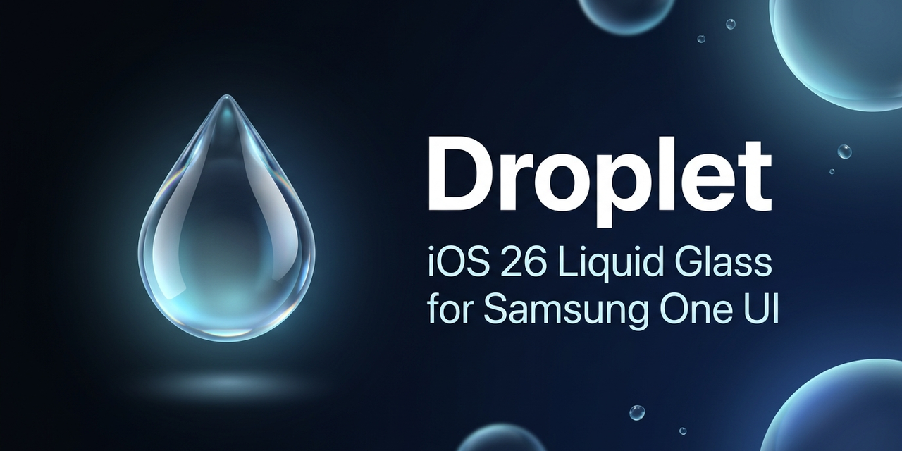
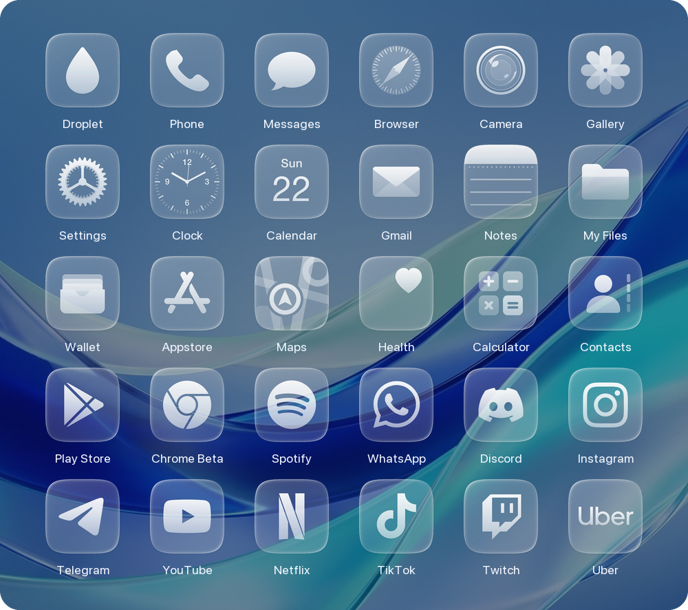
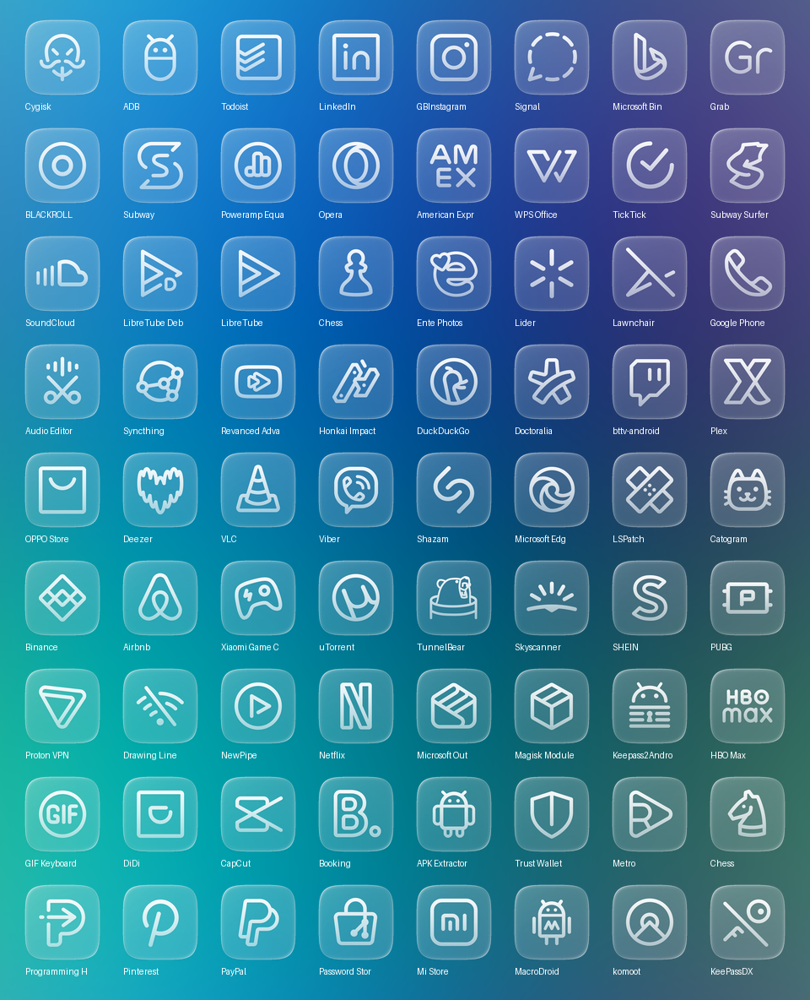

<p align="center">
  
</p>

<h1 align="center">Droplet</h1>

<p align="center">
  <strong>iOS 26 / 27 Clear Liquid Glass Icon Pack &amp; LSPosed Module for Samsung One UI (8 / 8.5 / 9+)</strong><br/>
  1,020+ solid-filled translucent frosted-glass icons with Apple continuous-squircle geometry, plus an optional built-in LSPosed module for true 120fps GPU AGSL live wallpaper refraction, convex lens magnification, chromatic dispersion, and gyroscope tilt caustics — all in one APK.
</p>

---

## Features

- **1:1 iOS 26 Clear Liquid Glass Aesthetic** — Calibrated against Apple's official iOS 26 Clear Home Screen: pure-white top-to-bottom translucent frosted glyphs, crystal-clear glass body so your wallpaper shines through, and razor-crisp anisotropic Fresnel specular rim catchlights (top-left `-135°` & bottom-right `+45°`).
- **1,020+ Solid-Filled Liquid Glass Icons** — Full coverage of mainstream & niche Android apps (mapped across 2,700+ `ComponentInfo` activities in `appfilter.xml`), combining bespoke iOS 26 Clear system icons, optically normalized stock glyphs, and 900+ **solid-filled** official brand vectors from [Simple Icons](https://simpleicons.org/).
- **Continuous Squircle Geometry** — Supersampled (`512×512` → `192×192`) smooth continuous squircle (`n = 4.50`) with exact Euclidean SDF normals and unified optical visual-weight scaling.
- **Built-In LSPosed Module (One UI 8 / 8.5 / 9+)** — Distributed inside the exact same `Droplet.apk` with a native **Samsung One UI Dark Settings interface**: master **On / Off** switch bar, automatic LSPosed detection & setup guide (grays out root-only controls if LSPosed isn't active), live **Clarity & Frost (`Clear Liquid` ↔ `Frosted`)**, **Magnification & Refraction**, and **Corner Light Glow** sliders, live module status, and **Restart Home / Restart SystemUI** controls:
  - **Heavily Optimized Real-Time Live Wallpaper Magnification & Refraction**: Pre-blurs lightweight `144×312` live wallpaper textures off the UI thread (<1.2ms) with scroll-aware capture pausing (120fps scrolling, zero lag), viewport-culled icon redraws, and a 1-tap center / 3-tap bevel AGSL lens shader (~18× fewer GPU texture fetches).
  - **Corner-Originating Apple iOS 26 Specular Glow**: Quiet hairline along straight edges with brilliant liquid-glass light arcs originating strictly from the 45° curved corners (`-135°` TL & `+45°` BR) and gliding live with phone tilt.
  - **App Drawer Extra-Blur Matching**: Automatically detects One UI's blurred App Drawer, Open Folders, and Overlay Apps containers and feeds a pre-heavily-blurred, gently dimmed backdrop texture so icons blend seamlessly instead of looking sharper than the blurred drawer behind them.
  - **1:1 Floating Frosted Glyphs & Glass Folders**: Bold, full-sized translucent frosted-white glyphs with soft suspended depth shadows floating inside each live magnifying glass tile (zero double borders).
  - **SystemUI Glass Polish**: Subtle translucent Liquid Glass specular rims in `com.android.systemui`.

## Icon Preview (288 of 1,020+ Icons)

| Part 1 | Part 2 |
| :---: | :---: |
|  |  |

| Part 3 | Part 4 |
| :---: | :---: |
|  |  |

## Installation

### Option A — No Root (Samsung Good Lock / Theme Park)
1. Download **`Droplet.apk`** from the [Releases](../../releases/latest) page and install it.
2. Open **Good Lock → Theme Park → Icon** (or open **Droplet → Icons tab → Apply via Theme Park**).
3. Tap **Create New → Iconpack → Third Party → Droplet**.
4. Keep **Shape** unmodified (original) and **Effects** set to **None** so One UI preserves the exact squircle geometry and specular glass rim.
5. Tap **Save** (top-right), name your pack, and tap **Apply**.

### Option B — LSPosed Module (One UI 8 / 8.5 / 9+ with Root)
1. Install **`Droplet.apk`** from [Releases](../../releases/latest).
2. Open **LSPosed Manager → Modules → Droplet** and enable it.
3. Tick the recommended scope:
   - **One UI Home** (`com.sec.android.app.launcher`)
   - **SystemUI** (`com.android.systemui`)
4. Open the **Droplet** app → **LSPosed Module** tab:
   - Toggle **Enable Droplet LSPosed Module** ON and choose your effects.
   - Check the **LSPosed Checklist & Live Status** panel.
   - Tap **Restart One UI Home** and **Restart SystemUI** to apply immediately.

## Building from Source

Requires Python 3.10+, JDK 17+, and Android SDK Build-Tools (`aapt2`, `d8`, `zipalign`, `apksigner`).

```bash
python3 -m venv .venv
.venv/bin/pip install -r requirements.txt
.venv/bin/python build_all_icons.py
.venv/bin/python expand_1000_icons.py
.venv/bin/python build_apk.py
```

## Notes

- Brand logos are sourced from [Simple Icons](https://simpleicons.org/) and belong to their respective trademark holders.
