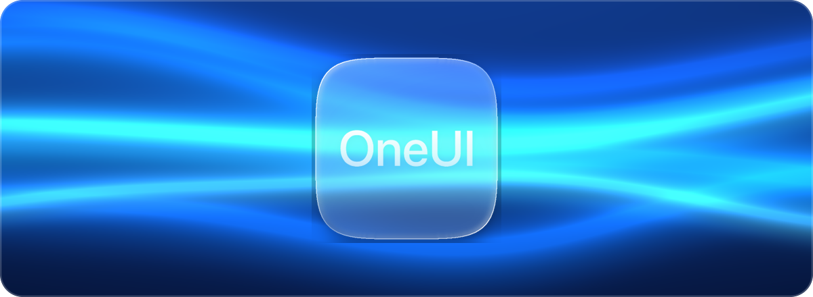
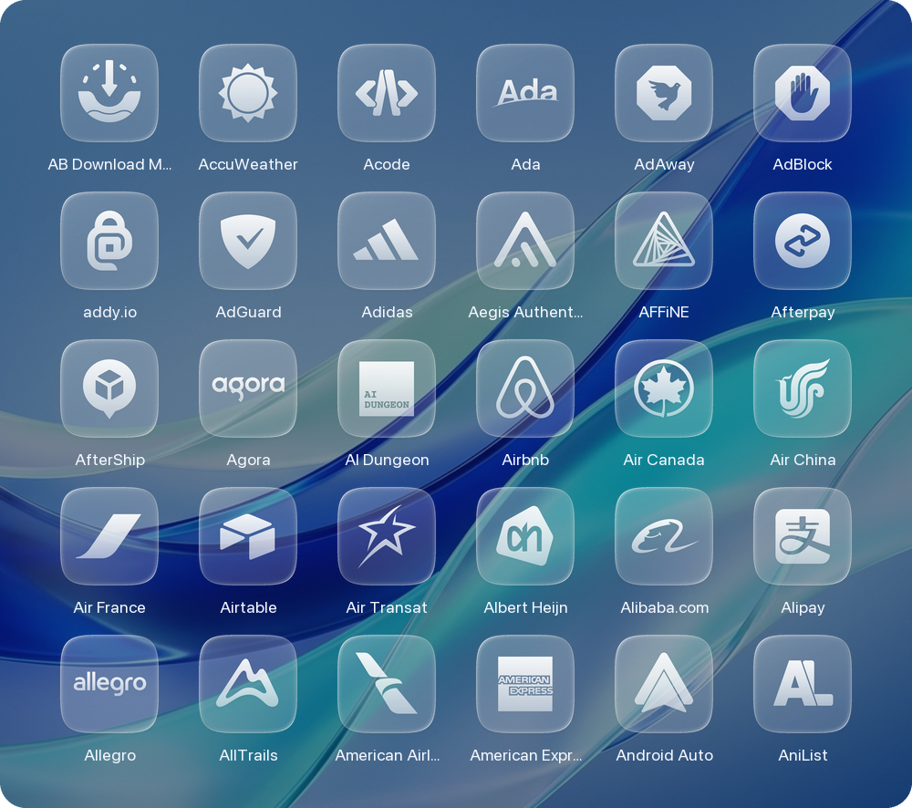
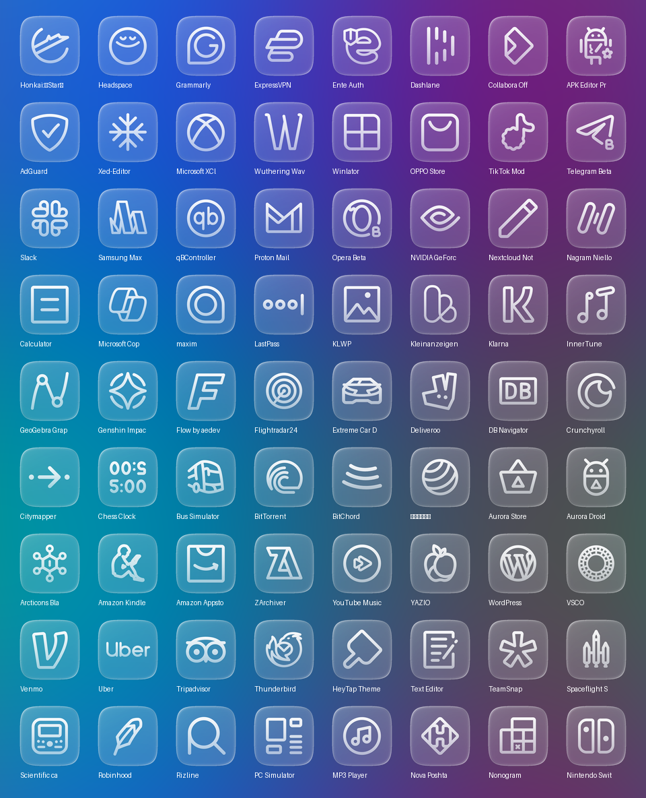

<p align="center">
  
</p>

<h1 align="center">OneLiquid</h1>

<p align="center">
  <strong>iOS 26 Clear Liquid Glass icon pack for Samsung One UI</strong><br/>
  Translucent frosted-glass icons with Apple continuous-squircle geometry, Fresnel specular rims, and consistent optical scaling.
</p>

---

## Features

- **1:1 iOS 26 Clear Liquid Glass Aesthetic** — Calibrated against Apple's official iOS 26 Clear Home Screen: pure-white top-to-bottom translucent frosted glyphs, crystal-clear glass body so your wallpaper shines through, and razor-crisp anisotropic Fresnel specular rim catchlights (top-left `-135°` & bottom-right `+45°`).
- **Continuous Squircle Geometry** — Supersampled (`512×512` → `256×256`) smooth continuous squircle (`n = 4.50`) with exact Euclidean SDF normals.
- **1,020+ Solid-Filled Liquid Glass Icons** — Full coverage of mainstream & niche Android apps (mapped across 2,700+ `ComponentInfo` activities in `appfilter.xml`), combining bespoke iOS 26 Clear system icons, optically normalized stock glyphs, and 900+ **solid-filled** official brand vectors from [Simple Icons](https://simpleicons.org/) so every single icon shares the exact same cohesive frosted-glass look.
- **Universal Launcher Fallback** — Includes `iconback`, `iconmask`, and `iconupon` Liquid Glass framing so unthemed apps still blend in.

## Icon Preview (288 of 1,020+ Icons)

| Part 1 | Part 2 |
| :---: | :---: |
|  |  |

| Part 3 | Part 4 |
| :---: | :---: |
|  |  |

## Installation (Samsung One UI)

1. Download **`OneLiquid.apk`** from the [Releases](../../releases/latest) page and install it.
2. Open **Good Lock → Theme Park → Icon** (or open the **OneLiquid** app and tap **Open Theme Park**).
3. Tap **Create New → Iconpack → Third Party → OneLiquid**.
4. Keep **Shape** unmodified (original) and **Effects** set to **None** so One UI preserves the exact squircle geometry and specular glass rim.
5. Tap **Save** (top-right), name your pack, and tap **Apply**.

## Building from Source

Requires Python 3.10+, JDK 17+, and Android SDK Build-Tools (`aapt2`, `d8`, `zipalign`, `apksigner`).

```bash
python3 -m venv .venv
.venv/bin/pip install -r requirements.txt
.venv/bin/python build_all_icons.py
.venv/bin/python build_apk.py
```

## Notes

- Brand logos in `official_svgs/` are sourced from [Simple Icons](https://simpleicons.org/) and belong to their respective trademark holders.
