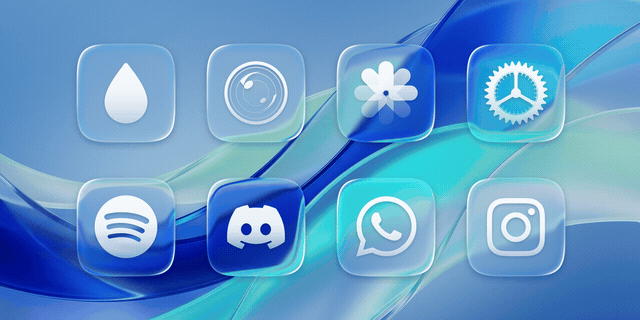
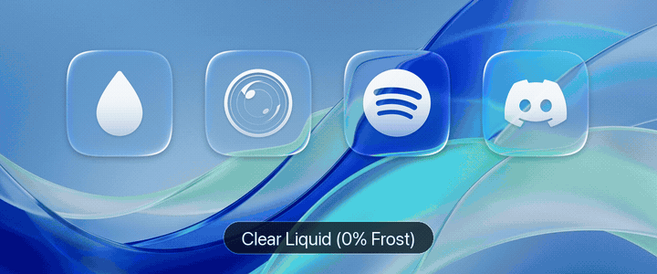

<p align="center">
  
</p>

<h1 align="center">Droplet</h1>

<p align="center">
  <strong>iOS 26 Clear Liquid Glass Icon Pack &amp; Real-Time LSPosed Module for Samsung One UI</strong>
</p>

<p align="center">
  <a href="../../releases/latest"></a>
  
  
  
</p>

---

## Live Liquid Glass in Action

<p align="center">
  <br/>
  <sub><em>Real-time convex lens magnification, curved bevel RGB dispersion, and tilt-reactive corner specular glow over live &amp; static wallpapers.</em></sub>
</p>

<p align="center">
  <br/>
  <sub><em>Live <strong>Clarity &amp; frost</strong> (0% pure crystal glass &harr; 100% heavy frost) and <strong>Optical Glass Tint</strong> (9 presets + Custom RGB picker) with instant 0ms updates.</em></sub>
</p>

---

## Two Ways to Use Droplet

Everything ships inside a single **`Droplet.apk`**. No-root users get the full 1,600+ icon pack immediately; rooted users with LSPosed unlock live GPU optical glass effects and real-time sliders.

| Capability | No Root (Theme Park) | Root + LSPosed Module |
| :--- | :---: | :---: |
| **1,600+ solid-filled iOS 26 Clear Liquid Glass icons** (`3,500+` app mappings) | &#x2705; | &#x2705; |
| **Apple continuous-squircle geometry** (`n = 4.50`) &amp; translucent frosted glyphs | &#x2705; | &#x2705; |
| **Live 120fps GPU wallpaper magnification &amp; curved bevel refraction** | &mdash; | &#x2705; |
| **Gyroscope tilt-reactive corner specular glow** | &mdash; | &#x2705; |
| **Live Clarity &harr; Frost, Magnification, Glow &amp; Optical Glass Tint sliders** | &mdash; | &#x2705; |
| **Automatic App Drawer extra-blur matching** | &mdash; | &#x2705; |
| **Glass Folders &amp; SystemUI specular rims** | &mdash; | &#x2705; |

---

## Capabilities

### Optical Liquid Glass Engine (Optimized for 120fps)
- **Live Convex Magnification &amp; Bevel Refraction**: Samples your live or static wallpaper at high-detail `360&times;780` with exact `mXOffset` viewport alignment, live multi-page `setWallpaperOffsets` tracking, hardware GPU bilinear filtering (`FILTER_MODE_LINEAR`), and a 1-tap center / 3-tap outer-bevel AGSL shader (`~18&times;` lighter than multi-tap shader blur).
- **Retina-Smooth Anti-Aliased Boundaries &amp; Corner Glow**: C1-smooth cubic SDF boundary anti-aliasing (`smoothstep(0.80, -0.80, sdf)`), silky `n = 3.2` corner lighting normals, and Nyquist-safe screen-pixel specular rim widths (`&ge; 1.18px`) eliminate jagged edges and dotted corner pixels so curved corner arcs look smooth like an iPhone display.
- **Zero-Stutter Scrolling &amp; Zero-GC Live Blur**: Double-buffered `Bitmap[2]` pools eliminate per-frame GC churn on live wallpapers, background capture pauses automatically during active touch/scroll for locked 120fps scrolling, and off-screen icons are culled.
- **App Drawer Extra-Blur Matching**: Automatically detects One UI's blurred containers (App Drawer, Open Folders, Overlay Apps, Suggested Apps) and switches those icons to a dedicated silky-blurred backdrop texture with calibrated luminance, softer dispersion, and balanced corner rims so they blend naturally into the blurred drawer.
- **Icons-Only &amp; Clean Stock Fallback**: Leaves Home Screen widgets untouched so your other One UI &amp; LSPosed modules keep working cleanly, and preserves the regular stock app icon intact for any unrecognised app not yet covered by Droplet.

### Simplified iOS Dark Companion App
- **Clean Apple iOS Settings Aesthetic**: Pure OLED black canvas, inset grouped `#1C1C1E` cards (`14dp` corners), hairline dividers, iOS Segmented Control (`Glass` | `Icons`), iOS System Blue (`#0A84FF`) sliders &amp; action rows, and iOS System Green (`#30D158`) switches.
- **Automatic LSPosed Detection**: Hides the setup guide automatically once LSPosed is active, and grays out root-only controls with a concise 3-step guide when inactive.
- **Live Sliders &amp; Dynamic Glass Tint**:
  - **Clarity &amp; Frost**: `0%` pure crystal-clear glass (zero white wash) &harr; `100%` heavy frosted glass.
  - **Magnification**: `Subtle` &harr; `Strong` convex lens &amp; curved bevel refraction.
  - **Corner Glow**: `Off` &harr; `Bright` specular corner highlights.
  - **Glass Tint &amp; Auto-Collapsing Tint Strength**: `None`, **`Auto` (`&#x2726;` wallpaper-adaptive dynamic tint)**, 9 curated glass presets, plus a **Custom RGB color picker** with live hex preview.
- **Live System Status &amp; One-Tap Restart**: Live connection status for LSPosed, One UI Home, and SystemUI, plus clean iOS action rows to **Restart One UI Home** and **Restart SystemUI**.

---

## Icon Pack Preview

*120 of 1,600+ solid-filled iOS 26 Clear Liquid Glass icons:*

| Core &amp; Popular | Apps &amp; Services |
| :---: | :---: |
|  |  |

| More Mainstream | Niche &amp; Utilities |
| :---: | :---: |
|  |  |

---

## Installation

### Option A — No Root (Samsung Good Lock / Theme Park)
1. Download **`Droplet.apk`** from [Releases](../../releases/latest) and install it.
2. Open **Droplet &rarr; Icons tab &rarr; Apply** (or open **Good Lock &rarr; Theme Park &rarr; Icon**).
3. Tap **Create New &rarr; Iconpack &rarr; Third Party &rarr; Droplet**.
4. Leave **Shape** unmodified and **Effects** set to **None** so One UI preserves the exact squircle geometry and specular rim.
5. Tap **Save** and **Apply**.

### Option B — Root + LSPosed (One UI 8 / 8.5 / 9+)
1. Download and install **`Droplet.apk`** from [Releases](../../releases/latest).
2. Open **LSPosed Manager &rarr; Modules &rarr; Droplet** and enable it.
3. Select the recommended scope:
   - **One UI Home** (`com.sec.android.app.launcher`)
   - **SystemUI** (`com.android.systemui`)
4. Open **Droplet**, customize your glass sliders/tint, and tap **Restart Home** (and **Restart SystemUI** if using SystemUI rims).

---

## Building from Source

Requires Python 3.10+, JDK 17+, and Android SDK Build-Tools (`aapt2`, `d8`, `zipalign`, `apksigner`).

```bash
python3 -m venv .venv
.venv/bin/pip install -r requirements.txt
.venv/bin/python build_all_icons.py
.venv/bin/python expand_1000_icons.py
.venv/bin/python build_apk.py
```

---

## Credits

- Brand vectors are sourced from [Simple Icons](https://simpleicons.org/) and belong to their respective trademark holders.
